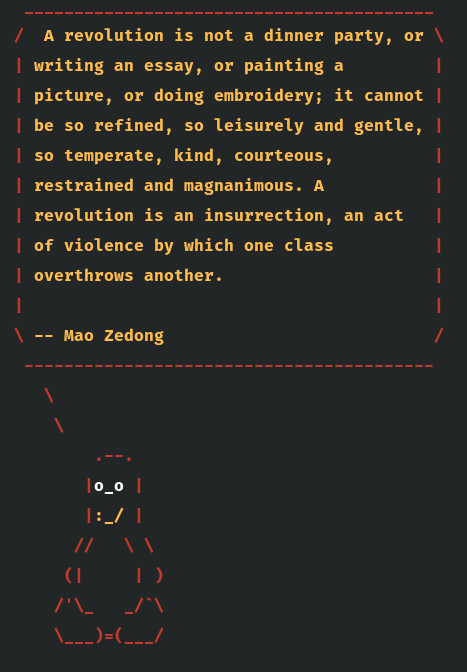

# marxsay

Tux the penguin, quoting revolutionaries in your terminal.

`marxsay` is a small set of shell aliases built on [`fortune`](https://en.wikipedia.org/wiki/Fortune_(Unix)), [`cowsay`](https://en.wikipedia.org/wiki/Cowsay) and [`lolcat`](https://github.com/busyloop/lolcat). It ships a custom fortune database of about 50 quotes from Marx, Engels, Sankara, Fisher, Trotsky, Che Guevara and Mao. Each new shell opens with one of them.



Plain-text output (`marxsay`):

```text
 _________________________________________
/  A revolution is not a dinner party, or \
| writing an essay, or painting a         |
| picture, or doing embroidery; it cannot |
| be so refined, so leisurely and gentle, |
| so temperate, kind, courteous,          |
| restrained and magnanimous. A           |
| revolution is an insurrection, an act   |
| of violence by which one class          |
| overthrows another.                     |
|                                         |
\ -- Mao Zedong                           /
 -----------------------------------------
   \
    \
        .--.
       |o_o |
       |:_/ |
      //   \ \
     (|     | )
    /'\_   _/`\
    \___)=(___/
```

## Requirements

- A Debian/Ubuntu-based system (the installer uses `dpkg` and `apt`)
- Bash
- `sudo`, only if `fortune-mod`, `cowsay` or `lolcat` are missing

## Installation

```bash
git clone https://github.com/pbertoni89/marxsay.git
cd marxsay
./setup.sh
source ~/.bashrc
```

`setup.sh`:

1. installs `fortune-mod`, `cowsay` and `lolcat` if they are missing;
2. copies `marxism.txt` to `~/.fortunes/marxism` and builds its index (`marxism.dat`) with `strfile`;
3. appends a configuration block to `~/.bashrc`, between `# MARXSAY_CONFIG_START` and `# MARXSAY_CONFIG_END`. If that block is already there, this step is skipped, so running the script again is safe.

## Usage

| Command       | Output                                                         |
|---------------|----------------------------------------------------------------|
| `marxsay`     | Plain Tux with a quote                                         |
| `marxsay-col` | Rainbow colours via `lolcat`                                   |
| `marxsay-red` | Red border, yellow text, white eyes, yellow beak (the default) |

A quote is printed every time a shell starts. To change which variant runs, or to turn it off, edit `defaultHello` in `setup.sh` **before** installing (`marxsay`, `marxsay-col`, `marxsay-red`, or `""`). After installing, edit the line just above `# MARXSAY_CONFIG_END` in `~/.bashrc` instead.

## Adding quotes

Quotes are stored in `marxism.txt`, in the standard fortune format: one entry per block, with blocks separated by a line holding only `%`.

```text
Quote text.

-- Author

%
```

Then run `./setup.sh` again to refresh the database in `~/.fortunes`. Your `~/.bashrc` is not touched a second time.

## Uninstall

```bash
rm -rf ~/.fortunes/marxism ~/.fortunes/marxism.dat
sed -i '/# MARXSAY_CONFIG_START/,/# MARXSAY_CONFIG_END/d' ~/.bashrc
```
